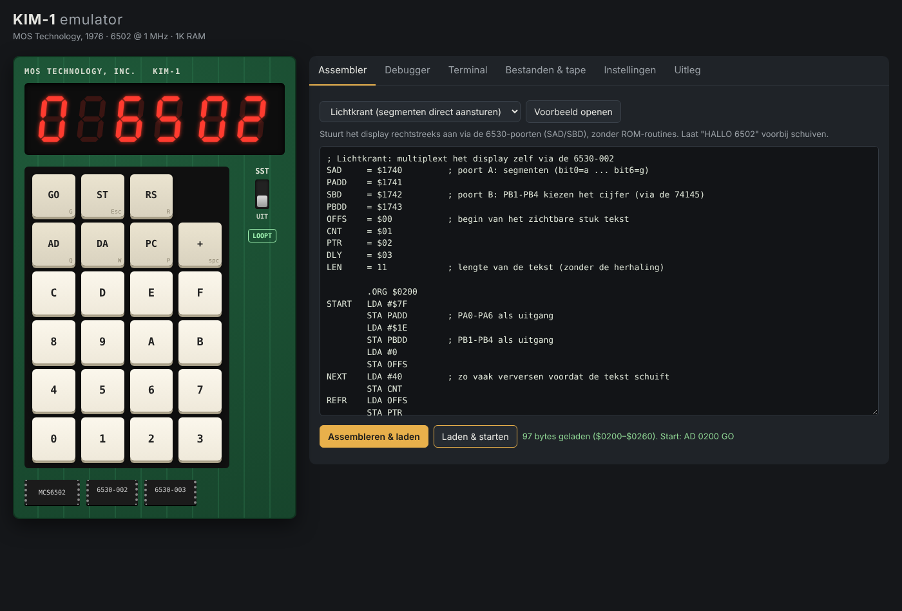

# KIM-1 en Junior Computer emulator

Twee emulators van 6502-eenbordscomputers, die in de browser draaien zonder
installatie, build-stap of afhankelijkheden:

- **MOS KIM-1** (1976), de computer waarmee MOS Technology de 6502 introduceerde
  (`index.html`);
- **Elektor/Elektuur Junior Computer** (1980), het bouwproject dat sterk op de
  KIM-1 lijkt (`junior.html`).



## Starten

De app gebruikt ES-modules, dus open hem via een (willekeurige) lokale webserver:

```sh
python3 -m http.server 8000
# open http://localhost:8000
```

## Wat zit erin

- **6502-CPU**: alle gedocumenteerde instructies, cyclustelling, NMOS-gedrag
  (decimale modus, `JMP ($xxFF)`-bug). Slaagt voor Klaus Dormann's 6502 functional test.
- **KIM-1-hardware**: 1K RAM, twee 6530 RRIOT's (poorten + timers), RAM op
  `$1780–$17FF`, 8K-adresspiegeling en optioneel uitbreidingsgeheugen.
- **LED-display** dat echt gemultiplext wordt via poort A/B van de 6530-002.
  Programma's die de segmenten zelf aansturen werken dus gewoon.
- **Keypad** (muis, touch of toetsenbord), **ST**, **RS** en de **SST**-schakelaar
  (single step).
- **Monitor**: een eigen nabootsing van de KIM-monitor (AD/DA/+/PC/GO, registers
  bewaren op `$EF–$F5`) en van de veelgebruikte ROM-routines zoals `SCANDS`,
  `GETKEY`, `AK`, `INCPT`, `OUTCH`, `GETCH`, `PRTBYT`, `CRLF` en de tabel `TABLE`.
  Wie een dump van de originele ROM heeft (2 KB, `$1800–$1FFF`) kan die laden onder
  *Instellingen*; dan draait de echte ROM-code.
- **Assembler** met labels, expressies en directives (`.ORG`, `.BYTE`, `.WORD`,
  `.TEXT`), plus voorbeeldprogramma's: teller, toetsen tonen, lichtkrant,
  "raad het getal" en een teletype-demo.
- **Debugger**: registers, disassembly, geheugen, pauze/stap en een breekpunt.
- **Terminal** voor de teletype-routines.
- **Bestanden & cassette**: laden/opslaan als KIM-papertape (`.ptp`), Intel HEX of
  binair; `DUMPT`/`LOADT` (`1800 GO` / `1873 GO`) schrijven naar een virtuele cassette.

## Junior Computer

- **Hardware**: 1K RAM, een 6532 RIOT (128 bytes RAM op `$1A00`, I/O en timer op
  `$1A80`, IRQ naar de 6502), 1K monitor-EPROM op `$1C00–$1FFF`, display met
  actief-lage segmenten, keypad en STEP-schakelaar.
- **Monitor**: nagebootst volgens de gepubliceerde listing van A. Nachtmann:
  keypadmonitor, hex-editor (`1CB5 GO`), assembler (`1F51 GO`), sprongberekening
  (`1FD5 GO`) en subroutines als `SCAND`, `SCANDS`, `AK`, `GETKEY`, `GETBYT` en
  `SHOW`. Met een eigen dump van de EPROM (1 KB) draait de echte monitorcode.
- De tests vergelijken de nagebootste monitor met de originele ROM-code
  (`JUNIOR_ROM=/pad/naar/monitor.bin npm test`): monitor, editor, assembler,
  sprongberekening en `SCANDS` gedragen zich identiek.

De Junior bestaat ook als desktop-app voor Windows en macOS: zie
[`desktop/README.md`](desktop/README.md).

## Snel proberen

1. Druk **AD**, tik `0200`, druk **DA** en tik `A9` **+** `42` **+** `00`.
2. Druk **AD** `0200` **GO**: het programma laadt `$42` in A en stopt bij de BRK.
3. Kijk op adres `$00F3` (A): daar staat `42`.

Of kies in de assembler een voorbeeld en klik **Laden & starten**.

Toetsenbord: `0–9 A–F` cijfers, `Q` = AD, `W` = DA, spatie/`+` = +, `G`/Enter = GO,
`P` = PC, `Esc`/`S` = ST, `R` = RS, `T` = SST aan/uit.

## Tests

```sh
npm test
# met de 6502 functional test (niet meegeleverd):
KLAUS_BIN=/pad/naar/6502_functional_test.bin npm test
```

## Opbouw

| Bestand | Inhoud |
| --- | --- |
| `js/cpu6502.js` | 6502-kern |
| `js/opcodes.js` | opcodetabel (gedeeld) |
| `js/board.js` | gemeenschappelijke basis: display, keypad, SST, uitvoering |
| `js/riot.js` | 6530 en 6532 RIOT |
| `js/kim1.js` | KIM-1: geheugen, 6530's, monitor |
| `js/junior.js` | Junior Computer: geheugen, 6532, monitor, editor, assembler |
| `js/app.js` | gebruikersinterface (gedeeld); `main.js` en `junior-main.js` starten hem |
| `js/assembler.js`, `js/disasm.js` | assembler en disassembler |
| `js/fileformats.js` | papertape en Intel HEX |
| `js/samples.js`, `js/samples-junior.js` | voorbeeldprogramma's |
